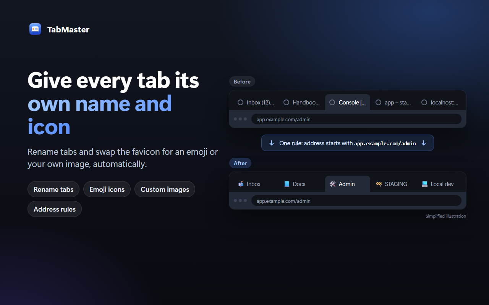
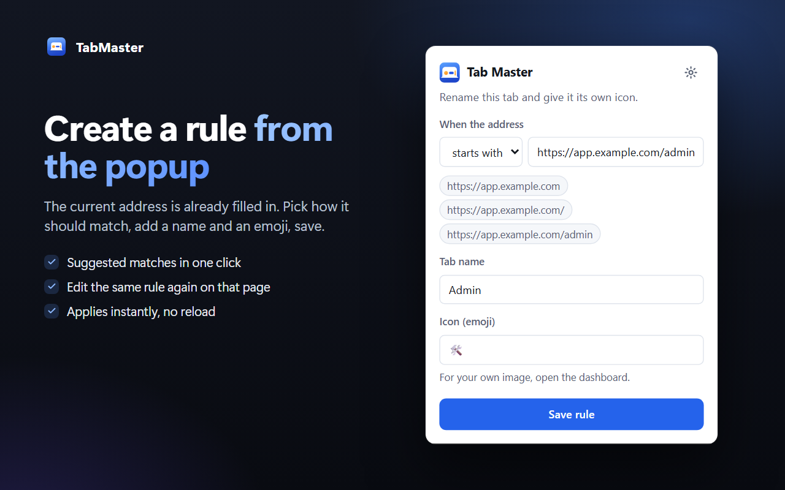
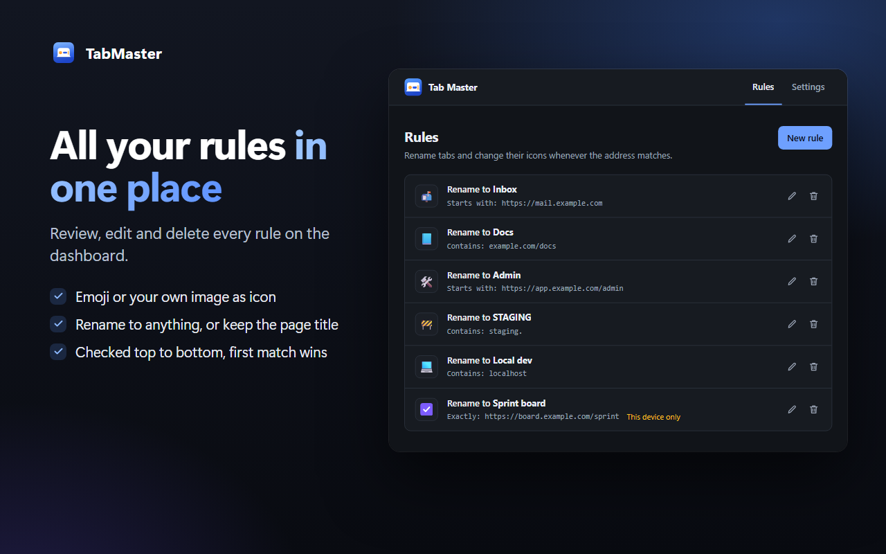
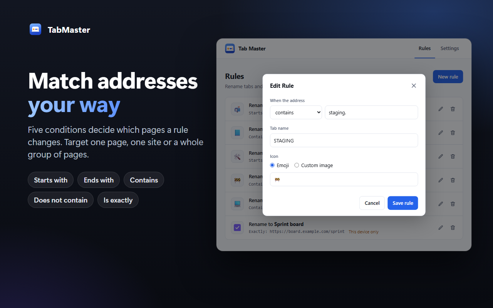
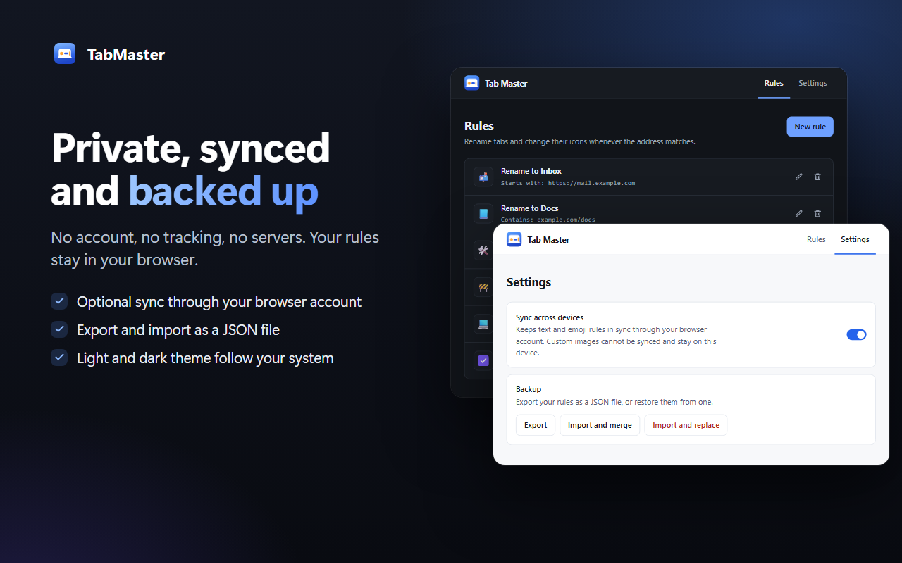

<h1 align="center">TabMaster – Rename Tabs & Change Tab Icons</h1>

<b>Rename your browser tabs and give them custom icons, automatically, with URL rules. Your rules stay in your browser: no account, no tracking.</b>

  
  
  
  

## Features

- **Rename tabs**: replace the title of any page with a name you choose, or keep the original title and only change the icon.
- **Change tab icons**: use any emoji as the favicon, or upload your own image (PNG, JPG, ICO or SVG).
- **Flexible URL rules**: match addresses that start with, end with, contain, do not contain or exactly equal your text. Matching ignores upper and lower case.
- **One-click suggestions**: the popup offers ready-made matches for the current page, such as the whole site or its first folder.
- **Works on modern web apps**: your title and icon stay in place when a site changes its own title or navigates without a reload.
- **Right-click menu**: customize the current tab for this tab only, for the exact page or for the whole website.
- **Rules dashboard**: see, edit and delete all your rules in one place.
- **Sync across devices (optional)**: text and emoji rules sync through your browser account. Custom images stay on the device where you added them.
- **Backup and restore**: export your rules as a JSON file, import them and merge, or replace everything.
- **Light and dark theme**: follows your system setting.

| | |
|---|---|
|  |  |
|  |  |

## Install

- **Chrome, Brave and other Chromium browsers:** [Chrome Web Store](https://chromewebstore.google.com/detail/mojpahfolammhpfnfdnghcnnpbaelnko)
- **Microsoft Edge:** [Edge Add-ons](https://microsoftedge.microsoft.com/addons/detail/rename-tabs-change-tab-/gjmmkdhondjbofkenaaooiknoffmmclc)
- **From source:** see [Development](#development).

## Getting started

1. Click the TabMaster icon on any page. The address of the page is already filled in.
2. Choose how it should match, type a new tab name and add an emoji. Use the dashboard if you prefer your own image.
3. Save. The tab updates instantly, no reload needed.
4. Click the gear button in the popup to open the rules dashboard.

## Permissions and privacy

Your rules are stored locally in your browser. Only if you switch on **Sync across devices**, text and emoji rules also travel through your browser's own sync service. TabMaster has no account, no analytics and no server. Read the [privacy policy](PRIVACY_POLICY.md).

| Permission | Why it is needed |
|---|---|
| `storage` | save your rules locally and, if enabled, sync them |
| `tabs` | tell open tabs to refresh their rules after a change, and clean up when a tab closes |
| `activeTab` | read the current tab's address to prefill a new rule from the popup |
| `contextMenus` | the "customize this tab" entry in the right-click menu |
| Access to all websites | a rule can target any address, so the script that sets titles and icons must run on every page. It reads only the page address. |

## Support

- Questions, bugs or ideas: [open an issue](https://github.com/exUs541/Rename-Tabs/issues).
- More about TabMaster and the other extensions: [exus541.github.io/portfolio](https://exus541.github.io/portfolio/index.html), with a [feedback form](https://exus541.github.io/portfolio/feedback.html).

## Development

The extension runs straight from this folder, there is no build step.

1. Clone the repository.
2. Open `chrome://extensions` (or `edge://extensions`) and switch on **Developer mode**.
3. Choose **Load unpacked** and select the repository folder.

| Path | Purpose |
|---|---|
| `manifest.json` | extension manifest (Manifest V3) |
| `background.js` | service worker: context menu, rule refresh |
| `content.js` | applies titles and icons on the page |
| `popup/` | quick-rule popup |
| `options/` | rules dashboard |
| `icons/` | extension icons |
| `store-assets/` | store texts, screenshots, logo sources and their generator, see its [README](store-assets/README.md) |
| `.github/` | release pipeline, see [RELEASING.md](.github/RELEASING.md) |

## License

MIT
